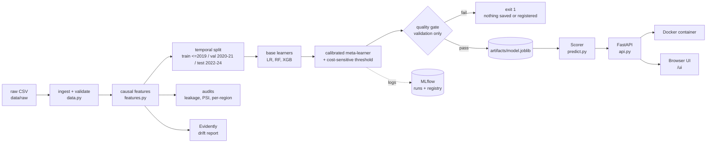
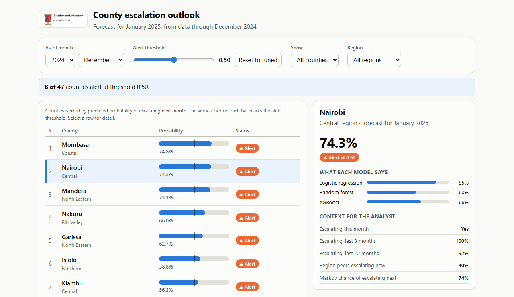

<p align="center"></p>

# ThreatGuard ST-BMSE: county-level conflict escalation forecasting (DSA 8401 capstone)

A reproducible ML pipeline and model service that forecasts **whether a Kenyan county will escalate next month**,
built from the proposal *"Spatio-Temporal Bayesian-Markov Stacked Ensemble for County-Level Conflict
Escalation Forecasting in Kenya"* (Esther Muthui, 223932).

**Lecturers:** Prof. Javier Serrano and Emmanuel Bundi

> **Read this first: the data are synthetic.** `data/raw/kenya_conflict_monthly.csv` holds simulated county-month
> records built to the proposal's design (47 counties x 120 months, 2015-2024, 2022-2024 held out as the test period).
> They are **not** observed Armed Conflict Location and Event Data Project events or Kenya National Bureau of Statistics statistics; using those is the proposal's planned next stage, and the
> pipeline consumes a fixed county-month schema so real data can replace the file. Treat every result as a
> **demonstration of the method**, not as evidence about real conflict in Kenya. See
> [reports/REPORT.md](reports/REPORT.md) section 7 for how the delivery relates to the proposal.

## Cost-sensitive alert threshold

The threshold is chosen on validation data by minimising

> threshold* = the threshold that minimises [ cost of a false negative × number of false negatives at that threshold + cost of a false positive × number of false positives at that threshold ], with cost of a false negative : cost of a false positive = 5 : 1

In words:

- **Threshold:** a county-month raises an alert when its predicted probability is at least the threshold.
- **False negatives:** real escalations that raised no alert (missed escalations).
- **Cost of a false negative:** the cost assigned to one missed escalation.
- **False positives:** alerts raised where no escalation followed (false alarms).
- **Cost of a false positive:** the cost assigned to one false alarm.
- **5 : 1:** one missed escalation is treated as five times as costly as one false alarm. This is an assumption, not an elicited value.

## What it does

| Question | Answer |
|---|---|
| Prediction | P(county escalates in month *t+1*), using only information known at month *t* |
| Unit | County-month (47 counties) |
| Model | Logistic Regression + Random Forest + XGBoost, blended by a calibrated logistic meta-learner, then a cost-sensitive alert threshold |
| Bayesian-Markov part | Empirical-Bayes shrunk transition probabilities P(escalate next \| current state), per county, from transitions seen so far |
| Spatial part | Same-region escalation share (a **proxy**: no county adjacency data was available) |
| Evaluation | Untouched 2022-2024 test period, county-block bootstrap confidence intervals, compared with a persistence baseline |
| Experiment tracking | **MLflow**: parameters, metrics, artifacts, nested run per learner, model registry with a `production` alias |
| Quality gate | Validation-only check; a failing model exits non-zero, is not saved and is not registered |
| Drift monitoring | **Evidently AI** report (inputs, predictions, target) plus a population stability index check |
| Continuous integration and continuous delivery | **GitHub Actions**: train + gate + tests + Docker build + container smoke test; push to GitHub Container Registry only from the default branch |
| Serving | FastAPI service, Docker image, `/predict` and `/predict/batch` |
| Frontend | A browser page served by the application programming interface: ranked counties, threshold slider, per-county detail |

## Architecture



## Quick start

Requires Python 3.12. From the repository root:

```powershell
python -m pip install -r requirements.txt     # full environment: training, MLflow, Evidently, tests
python run_pipeline.py                        # ingest -> train -> GATE -> MLflow -> audits -> Evidently -> rolling windows -> SHAP -> sample prediction (about 7 min)
python run_pipeline.py --tune                 # the same, plus the Optuna tuning study (5-10 more minutes; does not change the shipped model)
python -m pytest -q                           # 57 tests: leakage, the gate, MLflow, Evidently, rolling windows, tuning, SHAP, slim-install imports, the API and the browser UI page
python -m uvicorn stbmse.api:app --app-dir src --port 8000
```

Use a virtual environment kept **outside** any cloud-synced folder (for example `%LOCALAPPDATA%\stbmse-venv`), because
a Python environment is thousands of small files. For serving only, `requirements-api.txt` is enough.

Linux/macOS: the same commands work; use `python3` and `export PYTHONPATH=src` if you prefer not to pass `--app-dir`.

**The trained model is in the repository** (`artifacts/model.joblib`), so after installing `requirements-api.txt` you can
start the application programming interface immediately without training. About that file:

- It was trained on Windows with the pinned versions in `requirements-api.txt`, and it is the model behind every number in
  the report. Loading it needs those same versions (scikit-learn 1.8.0, XGBoost 3.4.1); other versions may fail or differ.
- `.joblib` files are Python pickles, which can run code when loaded. Only load a copy you trust, such as this repo's.
  `train.py` strips absolute local paths from the file before writing it.
- The Docker image and continuous integration **train their own model**, and on Linux it differs slightly (see the reproducibility notes),
  so the container does not serve this exact file. `python run_pipeline.py` regenerates it and overwrites the committed copy.
- Each retrain that is committed adds another 12 megabytes to the git history, so commit it deliberately, not by habit.

Then open http://127.0.0.1:8000/docs, or:

```powershell
Invoke-RestMethod http://127.0.0.1:8000/predict -Method Post -ContentType application/json `
  -Body '{"county":"Nairobi","year":2024,"month":12}'
```

```bash
curl -X POST http://127.0.0.1:8000/predict -H "Content-Type: application/json" \
     -d '{"county":"Nairobi","year":2024,"month":12}'
```

## Machine learning operations: tracking, quality gate, drift, continuous integration and continuous delivery

### Experiment tracking (MLflow)

Every `python run_pipeline.py` logs one parent run `st_bmse_ensemble` plus a nested run for each base learner.

```powershell
mlflow ui --backend-store-uri sqlite:///mlflow.db        # http://127.0.0.1:5000
```

Open the experiment `stbmse-county-escalation`, select the runs and click **Compare**. **Models -> stbmse-ensemble**
shows the versions and which one carries the `production` alias. The store (`mlflow.db`, `mlruns/`) is generated and
not committed; point `MLFLOW_TRACKING_URI` elsewhere to move it. Tracking is skipped automatically if MLflow is not
installed (the Docker image) or if `STBMSE_TRACKING=off`.

### Quality gate

The gate runs on **validation data only**, so the 2022-2024 test period never influences whether a model ships. It requires:
the best base learner beats the persistence baseline by at least **0.05 precision-recall area under the curve**; scores are finite; validation has both
classes; the alert threshold is not at the edge of the search grid. A failed gate exits with code 1, writes no
`artifacts/model.joblib` and registers nothing (the failed run is still logged, tagged `quality_gate=failed`).

**Try breaking it** (the same exercise as in the lab's `fraud_mlops`):

```powershell
$env:STBMSE_MIN_GAIN = "0.9"; python run_pipeline.py --fast --skip-audit; echo $LASTEXITCODE    # prints 1
Remove-Item Env:\STBMSE_MIN_GAIN
```

### Modelling depth: rolling windows, tuning and Shapley additive explanations

Three analyses sit on top of the main evaluation. Each writes its results to `reports/`, and none changes the shipped model.

| Analysis | Run | Output |
|---|---|---|
| **Rolling-origin evaluation**: the whole procedure repeated with the cut moved forward one year at a time (5 windows, 2020-2024) | part of `python run_pipeline.py`, or `python -m stbmse.rolling` | `rolling_origin.csv` |
| **Shapley additive explanations**: exact per-learner attribution (linear Shapley additive explanations, tree Shapley additive explanations), additivity-checked, combined with the stacker's weights | part of `python run_pipeline.py`, or `python -m stbmse.explain` | `shap_importance.csv`, `shap_summary.json` |
| **Optuna tuning study**: time-ordered folds that never touch 2022-2024, fixed versus tuned compared like for like | `python run_pipeline.py --tune`, or `python -m stbmse.tune --trials 25` (5-10 minutes) | `tuning_results.json`, `tuned_params.json`, `tuning_per_year.csv` |

Headline findings: the ensemble beats persistence in all five windows (gain +0.08 to +0.18); tuning raises test precision-recall area under the curve
from 0.608 to 0.641 (paired +0.033, uneven by year) but the tuned settings are **not adopted**, because that would change
every published number; and Shapley additive explanations and permutation importance agree on the top feature only moderately overall (rank
correlation 0.49). Adopting the tuned settings is the author's decision: the settings are in `reports/tuned_params.json`.

### Drift report (Evidently)

`reports/evidently_drift_report.html` (open in a browser) compares the training period with the test period for inputs, the
model's predictions and the target; `reports/evidently_drift_summary.json` has the machine-readable result. On the
current data 27 of 32 columns drift, including the model's own predictions. Run it alone with `python -m stbmse.monitor`
(with `PYTHONPATH=src`). It complements the hand-built population stability index check in `audit.py`.

### Continuous integration and continuous delivery (GitHub Actions)

[`.github/workflows/ci.yml`](.github/workflows/ci.yml) expects this folder to be the repository root.

| Job | When | Does |
|---|---|---|
| `ci` | every push and pull request | install; `python run_pipeline.py --fast` (**gate**, MLflow, audits, Evidently); `pytest`; `docker build`; run the container and call `/health`, `/predict` and an invalid request (must be 422); upload reports |
| `cd` | push to `main`/`master` **and** `ci` passed | log in to `ghcr.io` with the built-in `GITHUB_TOKEN`; build and push `ghcr.io/<owner>/stbmse-api:latest` and `:<commit sha>` |

A failed gate stops `ci` at the training step, so nothing after it runs and nothing is published.

> **Status: ran green on GitHub on its first push** (run 44397520310): the `ci` job (install, train with the gate,
> audits and Evidently, 27 tests, Docker build, container call) and the `cd` job (build and push to the container
> registry) both succeeded. Not verified: the published image was not listed independently (the available token lacks
> the `read:packages` scope), the workflow has not been checked with a linter such as `actionlint`, and the gate's
> blocking behaviour was proven locally (exit code 1, nothing saved) rather than on GitHub.

### Docker

```bash
docker compose up --build          # builds the image, trains inside the build (gate included), serves on :8000
curl http://127.0.0.1:8000/health
```

The image installs only `requirements-api.txt` (no MLflow, Evidently or test tools) and trains with `--fast
--skip-audit --no-tracking`. The quality gate still runs during the build, so a failing gate fails `docker build`.

> Verified on the authoring machine (Docker Desktop 4.99 / Engine 29.9, Windows 11): the image builds, the container
> reports `healthy`, runs as a non-root user, and `/health`, `/predict` and input validation were exercised over hypertext transfer protocol status.
> The image is 1.3 gigabytes. Part of that (about 200 megabytes) is a graphics processing unit-communication library that XGBoost's Linux wheel pulls in
> and this central processing unit-only service does not use; a central processing unit-only XGBoost build would likely avoid it, but I did not try. If a build
> fails elsewhere, check the pinned versions in `requirements-api.txt` and the `libgomp1` install that XGBoost needs.

## Frontend: the analyst view

Open **http://127.0.0.1:8000/** (it redirects to `/ui`) once the application programming interface is running; it also works from the Docker container.



- **Ranked table** of all 47 counties by predicted probability of escalating next month, with a tick on each bar marking the alert threshold.
- **Controls:** as-of month, an alert-threshold slider (with *Reset to tuned*), alerts-only / top-10 filters and a region filter.
- **Detail panel:** what each of the three models says, plus context an analyst can check (recent escalation history, region peers, the Markov estimate).
- **Honest about the alert problem:** when the threshold makes nearly every county alert (as the tuned 0.18 does), the page says so and tells the analyst to raise it.
- **Shareable links:** the state lives in the URL, for example `/ui#county=Nairobi&y=2023&m=6&t=0.55`; add `&theme=dark` to force dark mode.

Design notes: it is a single static page the application programming interface serves, so there is nothing extra to install or deploy, and it is a real
client of the JavaScript Object Notation application programming interface (`/periods`, `/predict/batch`). Application programming interface values are inserted as text, never as hypertext markup language; a test enforces
that, and that the page makes no external requests. The lab repository's frontend is a separate Streamlit app calling the
Application programming interface; if your course expects Streamlit specifically, that would be a thin wrapper around the same endpoints.

Checked in a real browser (headless Edge, desktop, phone width, light and dark) and served from the Docker container.
It has **not** been tested in Firefox or Safari, or with a screen reader; rows are keyboard-focusable with Enter/Space.

## Live deployment on Render

`render.yaml` describes the web service. On https://render.com: sign in with GitHub, choose **New, Blueprint**, select this
repository and apply. Render builds the Docker image (the model is trained inside the build), checks `/health`, and serves
the browser page at the service address it gives you (the first request after idle time takes about a minute on the free plan).
Not yet deployed: the live link is added here once the service exists.

## Application programming interface

| Method | Path | Purpose |
|---|---|---|
| GET | `/` , `/ui` | the browser user interface |
| GET | `/periods` | scorable months and the tuned alert threshold |
| GET | `/health` | liveness, data range, county count |
| GET | `/model-info` | version, split sizes, threshold, test metrics |
| GET | `/counties` | valid county names |
| POST | `/predict` | `{county, year, month, threshold?}` -> probability, alert flag, base-model probabilities, context |
| POST | `/predict/batch` | `{year, month, top_k?, threshold?}` -> counties ranked by risk |

Errors: unknown county or a month outside the data -> 404; invalid input (for example month 13) -> 422.
The response is **decision support for a human reviewer**, not an automated decision.

## Repository layout

```
run_pipeline.py            one-command reproduction (exit 1 if the quality gate fails)
src/stbmse/
  config.py                paths, split years, cost ratio, seeds
  data.py                  ingest, schema/integrity validation, data-quality report
  features.py              causal features, empirical-Bayes Markov, temporal split
  modeling.py              stacked ensemble, threshold, metrics, bootstrap confidence intervals, calibration
  gate.py                  quality gate (validation-only)
  tracking.py              MLflow tracking and model registry (optional dependency)
  train.py                 fit, gate, evaluate, track, serialise
  audit.py                 leakage audit, population stability index drift, per-region performance
  monitor.py               Evidently drift report (optional dependency)
  rolling.py               rolling-origin (expanding-window) evaluation
  tune.py                  Optuna tuning study (optional dependency; does not change the shipped model)
  explain.py               Shapley additive explanations (optional dependency)
  predict.py               Scorer (used by CLI and API)
  api.py                   FastAPI service (also serves the browser UI)
  static/index.html        the analyst view: one self-contained page, no build step, no external requests
.github/workflows/ci.yml   continuous integration and continuous delivery
latex/                     report.tex, slides.tex (Beamer), make_figures.py -> the report and slides PDFs in reports/
tests/                     57 tests (leakage, splits, validation, gate, MLflow, Evidently, rolling windows, tuning, SHAP, slim install, API, UI)
artifacts/                 model.joblib (11.8 MB), metrics.json: the serialized model, committed on purpose
final/                     convenience copy of the deliverables, grouped in five numbered folders (every file also lives at its normal path above)
reports/                   REPORT.md + generated CSV/JSON/HTML results
data/raw/                  input CSV
Dockerfile, docker-compose.yml, AI_USE.md
requirements.txt           full environment (runtime + MLflow + Evidently + tests)
requirements-api.txt       serving/training runtime only (used by the Docker image)
```

## Results in one paragraph

On the untouched 2022-2024 test period the ensemble reaches precision-recall area under the curve 0.61 (95% confidence interval 0.52-0.69) against 0.50 for the
persistence baseline; the paired improvement of +0.11 (confidence interval 0.06-0.16) is real. It is **not** better than a single
Random Forest (difference -0.01, confidence interval -0.03 to +0.02). The cost-tuned threshold produces a high false-alarm rate, and at
that threshold 46 of 47 counties raise an alert in December 2024. A leakage audit shows that same-month features give
Precision-recall area under the curve 0.97 (a nowcast, not a forecast) versus 0.61 for the honest one-month-ahead task. Evidently finds that 27 of 32
columns drifted between the training and test periods, including the model's predictions. Full numbers, limitations and
technique justification: [reports/REPORT.md](reports/REPORT.md).

## Rebuilding the PDF report and slides

```powershell
python latex/make_figures.py                    # charts from reports/ and artifacts/
cd latex
pdflatex report.tex; pdflatex report.tex; pdflatex report.tex     # three passes resolve references
pdflatex slides.tex; pdflatex slides.tex
```

Needs a LaTeX distribution (MiKTeX or TeX Live) with `beamer`, `tikz`, `booktabs` and `longtable`.

## Reproducibility notes

- Seeds are fixed (`config.SEED = 42`); the temporal split uses no shuffling.
- A clean virtual environment built from `requirements.txt` reproduces the earlier results exactly (ensemble test precision-recall area under the curve 0.6077).
- `python run_pipeline.py --fast` uses fewer bootstrap/permutation repeats (Docker build and continuous integration use it); point metrics are identical, only confidence intervals differ slightly.
- **Not bit-identical across operating systems.** Training the same code in the Linux Docker image and on Windows gives identical Logistic Regression and Random Forest results but a slightly different XGBoost. The ensemble precision-recall area under the curve differs in the third decimal (0.6092 in Docker versus 0.6077 on Windows), while threshold-dependent numbers move more (tuned threshold 0.16 versus 0.18; false-alarm rate 0.89 versus 0.81). `reports/REPORT.md` quotes the Windows run; a Docker rebuild will give slightly different alert-level figures. Conclusions do not change.
- The 5:1 missed-to-false-alarm cost ratio is an **assumption** in `config.py`, not an elicited value. So is the gate margin (0.05 precision-recall area under the curve).
- To add newer months, append rows with the same schema to the raw comma-separated values and restart the service; retrain with `python run_pipeline.py`.

## Short forms and names explained

- **Spatio-Temporal Bayesian-Markov Stacked Ensemble:** the method of this project. Its code package is named `stbmse`, which is just the initials of these words and appears only in file, folder and command names.
- **DSA 8401:** the course code of Applied Machine Learning at Strathmore University (Master of Science in Data Science and Analytics).
- **Threshold:** the probability above which a county-month raises an alert.
- **False negative / false positive:** a missed escalation / a false alarm (listed in this order everywhere).
- **XGBoost:** a gradient-boosted decision-tree library, one of the three base learners.
- **MLflow:** an open-source tool that records experiment runs and registers models.
- **Optuna:** an open-source library for hyperparameter search.
- **Evidently:** an open-source library that produces data and prediction drift reports.
- **FastAPI:** a Python web framework used for the prediction service.
- **Docker:** software that packages the service and its dependencies into a container image.
- **GitHub Actions:** GitHub's automatic workflow runner, used here for continuous integration and continuous delivery.
- **Shapley additive explanations:** a method that splits each prediction into the contribution of each input feature.
- **Persistence baseline:** the simple forecast that next month's escalation equals this month's.
